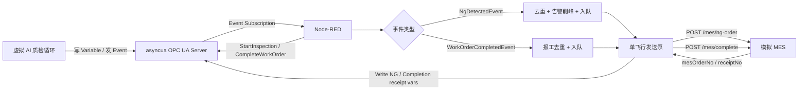
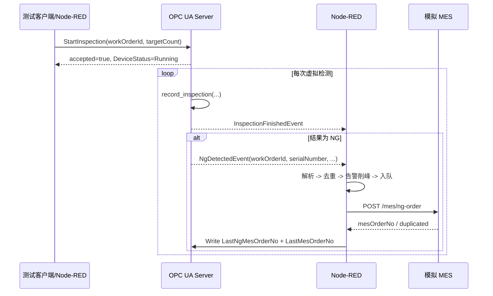
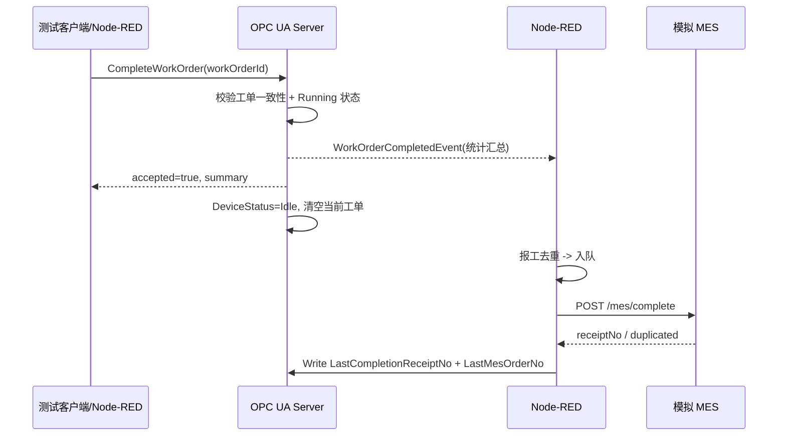

# 项目全景与架构

## 1. 项目定位

这是一个零硬件成本的工业质检 OT-IT 链路原型，目标不是训练真实视觉模型，而是完整演示以下工程闭环：

```text
AI 质检结果 -> OPC UA 语义模型 -> 边缘规则与可靠传输 -> MES 工单/报工 -> 回执归档
```

它重点回答四个问题：

1. 质检结果如何用标准工业协议表达？
2. 工单状态如何被安全地改变，而不是被任意 Write 覆盖？
3. 边缘节点如何在 MES 不稳定时可靠补传？
4. 派工单号与 MES 回执号如何保持语义分离？

## 2. 组件与职责

| 组件 | 文件 | 职责 | 不应承担的责任 |
|---|---|---|---|
| OPC UA Server | `server/qc_server.py` | 建立地址空间；维护工单/统计状态；模拟 AI 数据源；发事件 | 不做 MES HTTP 调用 |
| Node-RED 流 | `nodered/flows.json` | 订阅事件；解析/去重/削峰；缓冲；重试；调用 MES；写回 UA | 不自行判断“数量够了就报工” |
| 模拟 MES | Node-RED `http in` 节点 | 接收 NG 开单/完工报工；返回回执；按指纹防重；故障注入 | 不是生产架构，只是仿真道具 |
| 测试客户端 | `tests/*.py` | 以 UA Client 视角验证模型与链路 | 不参与业务运行 |

## 3. 总体架构



## 4. 两条核心业务时序

### 4.1 开检与 NG 开单



### 4.2 完工报工



关键点：`CompleteWorkOrder` 是唯一的报工发令枪。Node-RED 不根据检测数量自行报工。

## 5. 三个状态机

### 5.1 工单/设备状态

| 当前状态 | 事件 | 结果 |
|---|---|---|
| Idle | `StartInspection` 合法工单和正目标数 | Running，绑定工单 |
| Running | 同工单再次 `StartInspection` | 幂等接受，返回 `already running` |
| Running | 不同工单 `StartInspection` | 拒绝，不覆盖当前工单 |
| Fault | `StartInspection` | 拒绝 |
| Running | 正确工单 `CompleteWorkOrder` | 发完工事件，回 Idle，清空工单 |
| 非 Running | `CompleteWorkOrder` | 拒绝 |

### 5.2 MES 缓冲队列

```text
PENDING --发送泵取走--> SENDING
SENDING --2xx 成功--> SUCCESS / 出队
SENDING --失败--> PENDING + 1s/2s/4s 退避
SENDING --第 3 次退避后仍失败--> FAILED / 进入死信，不阻塞后续任务
```

同一时刻只允许一条 `SENDING`，这就是“单飞行发送泵”。

### 5.3 去重

| 分支 | Node-RED 指纹 | MES 第二道防线 |
|---|---|---|
| NG 开单 | `serialNumber + occurredAt`，并保留 `serialNumber` 兜底 | 同 `serialNumber` 返回原 `mesOrderNo` + `duplicated:true` |
| 完工报工 | `workOrderId` | 同 `workOrderId` 返回原 `receiptNo` + `duplicated:true` |

## 6. 数据如何贯穿全链路

一次 NG 的可追溯键有三个：

```text
imageId -> serialNumber -> workOrderId -> mesOrderNo
```

| 标识 | 产生方 | 存放位置 | 用途 |
|---|---|---|---|
| `imageId` | 虚拟质检源 | `LastImageId`、事件字段、MES 请求 | 定位图像样本 |
| `serialNumber` | 虚拟质检源/产线 | `CurrentPartSN`、事件字段、MES 请求 | 单件追溯 |
| `workOrderId` | MES/测试客户端经 Method 下发 | `CurrentWorkOrderId` | 绑定生产工单 |
| `mesOrderNo` | 模拟 MES | `LastNgMesOrderNo`，兼容镜像 `LastMesOrderNo` | MES 开单受理凭证 |
| `receiptNo` | 模拟 MES | `LastCompletionReceiptNo`，兼容镜像 `LastMesOrderNo` | 完工报工凭证 |

## 7. 范围边界：哪些是真实的，哪些是仿真的

| 能力 | 当前实现 | 生产化替换方向 |
|---|---|---|
| 视觉推理 | 随机 OK/NG、缺陷类型、置信度 | YOLOv8 或真实质检数据源 |
| OPC UA 传输 | 本地 CA + `Basic256Sha256_SignAndEncrypt` | 企业 PKI、证书轮换、按角色最小权限 |
| MES | Node-RED `http in` 假扮 | 真 MES HTTP/消息总线 |
| 缓冲 | Node-RED localfilesystem context | SQLite、Redis 或消息队列 |
| 告警 | debug/warn 日志与节点状态 | 灯、看板、告警平台 |
| 历史数据 | 不做 UA Historical Access | InfluxDB、SQLite、时序库 |

## 8. 已知差异与限制

这些差异是理解项目时必须知道的，不应在答辩中误述为“完全一致”：

1. **事件命名层次**：设计文档中的 Event 表使用“事件实例”视角；实际实现是继承 `BaseEventType` 的 EventType 节点，并由 `QCStation.Events` 作为 Notifier 触发。
2. **故障场景覆盖边界**：5xx、timeout 和 UA Method 拒绝已由 `tests/fault_scenarios.py` 自动化；但 Node-RED 注入节点触发的“拒绝后无 MES 请求”仍建议补一条流级测试。
3. **context 持久化不是事务数据库**：Node-RED 使用 localfilesystem context，`flushInterval: 1`，进程崩溃仍可能丢失最后约 1 秒写入；高可靠场景应升级 SQLite/独立队列。
4. **单实例原型**：当前模型只有一个 `QCStation`，没有多工位/多租户抽象。
5. **DeviceStatus 不是真枚举**：当前是 `Int32`，`0/1/2` 含义靠约定；生产化可升级为 `QCDeviceStatus` EnumDataType。
6. **安全仍是实验级配置**：已启用本地 CA、签名加密和管理员账号权限，但尚未接入企业 PKI、设备身份分级和跨网生产隔离。
7. **Python 3.14 环境已验证**：项目原有 Windows `.conda` 不再适用于 Ubuntu；Linux 使用 `.venv`。

## 9. 关键设计决策

| 决策 | 原因 | 代价 |
|---|---|---|
| 字符串 NodeId `ns=2;s=...` | 可读、便于教学和调试 | 比数字 NodeId 更长 |
| 自定义事件继承 `BaseEventType` | 符合 OPC UA 事件模型，可复用订阅机制 | 客户端需正确选择 EventType 才能拿到自定义字段 |
| Method 内做业务校验 | 避免任意写变量破坏状态机 | 调用方必须处理拒绝原因 |
| `CurrentWorkOrderId` 与三类回执变量分离 | 派工号、NG 回执、完工回执语义不同 | 变量数量增加，但追溯边界清晰 |
| 单飞行 + 退避 + 死信 + 文件 context | 控制并发、避免阻塞、失败可处置、重启可恢复 | 吞吐量受限，非事务型持久化 |
| NgRate 空窗口返回 `-1.0` | 区分“无样本”和“零不良” | 消费方必须专门处理哨兵值 |

