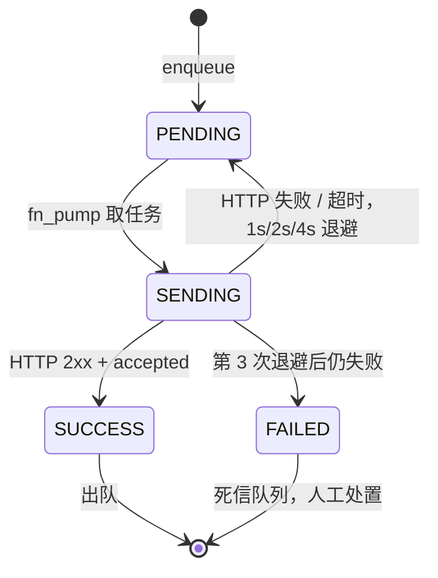

# 代码与 Node-RED 导读

本文按“先看状态，再看入口，再看链路”的顺序解释代码。目标不是背实现，而是能从任意一个现象定位到对应代码或节点。

## 1. 仓库地图

| 路径 | 作用 |
|---|---|
| `server/qc_server.py` | OPC UA Server、虚拟质检源、信息模型 |
| `server/requirements.txt` | Python 依赖，当前为 `asyncua==2.1.0` |
| `nodered/flows.json` | Node-RED 流导出文件 |
| `nodered/flows.legacy.json` | 旧版流，仅作历史参考 |
| `tests/smoke_test.py` | M1 模型、Method、事件、权限测试 |
| `tests/nodered_e2e.py` | M2 正常链路自动化测试 |
| `docs/M1_业务口径与MES契约.md` | 业务规则和 MES 字段契约 |
| `docs/M2_验收与测试场景.md` | 边缘流红线与验收场景 |

## 2. Python Server 阅读顺序

### 2.1 配置与状态容器

阅读：`server/qc_server.py:26-60`

要点：

- `NS_URI` 固定为 `urn:fde:linqinspect:qc`。
- `DEFECT_CODES` 是虚拟缺陷源。
- 端口、自动检测、间隔、NG 概率、窗口大小全部来自环境变量。
- `QCStation` 保存设备状态、工单、计数、滑动窗口和节点字典 `self.nd`。

### 2.2 建立地址空间

阅读：`server/qc_server.py:63-139`

执行顺序：

1. 注册命名空间，取得索引 `ns`。
2. 创建 `QCStation`、`Inspection`、`Statistics`、`Events`。
3. 对 `Events` 设置 `SubscribeToEvents`。
4. 创建 6 个根层 ReadWrite 变量（含两个拆分回执变量和兼容镜像）。
5. 创建 6 个 Inspection 只读变量。
6. 创建 3 个 Statistics 只读变量。
7. 创建 3 个继承 `BaseEventType` 的 EventType。
8. 创建 3 个 Method。

理解点：`_ro(node)` 和 `_rw(node)` 不是装饰，它们直接影响客户端能否写入。Node-RED 写三个 MES 回执变量失败时，应先检查 AccessLevel。

### 2.3 事件触发

阅读：`server/qc_server.py:141-148`

`_fire()` 做三件事：

1. 根据事件类型和事件源创建 EventGenerator。
2. 把业务字段赋给事件对象。
3. 设置 Severity、Message 并触发。

### 2.4 Method 校验

阅读：`server/qc_server.py:150-205`

必须记住：

- `StartInspection` 先判断空工单、Running、Fault、目标数，最后才改状态。
- `CompleteWorkOrder` 先判断无活动工单、工单不一致、状态不对，最后才发事件并回 Idle。
- `ResetCounters` 清累计统计和窗口，`NgRate` 回到 `-1.0`。

### 2.5 检测结果落地

阅读：`server/qc_server.py:207-256`

`record_inspection()` 的顺序：

1. 更新累计计数和滑动窗口。
2. 写 `LastResult`、`LastDefectType`、`LastConfidence`、`LastImageId`、`LastTimestamp`。
3. 写 `CurrentPartSN`。
4. 写统计和 `NgRate`。
5. 发 `InspectionFinishedEventType`。
6. 如果 NG，再发 `NgDetectedEventType`。

注意：一次 NG 会收到两个事件，这解释了为什么 Node-RED 必须按事件类型分流。

### 2.6 虚拟质检与启动

阅读：`server/qc_server.py:258-305`

- 只有 `DeviceStatus=Running` 时才生成样本。
- 样本 SN 格式为 `SN-<UTC日期>-<六位序号>`。
- 图像号格式为 `IMG-<UTC日期>-<六位序号>`。
- `main()` 创建 Server、设置 Endpoint、关闭安全策略、构建模型并运行。

## 3. Node-RED 六个功能区

在 Node-RED 编辑器中，流被注释分为六个区：

| 区域 | 节点 | 作用 |
|---|---|---|
| ① UA 事件接入 | `opcea` / `opcea_done` / `opc_evt` / `opc_evt_done` | 订阅两个具体 EventType，5 秒后重发一次订阅消息 |
| ② NG 分支 | `fn_parse` / `fn_dedup_ng` / `fn_alarm` / `fn_enq_ng` | 解析、陈旧过滤、去重、告警削峰、入队 |
| ③ 报工分支 | `fn_parse` / `fn_dedup_done` / `fn_enq_done` | 解析、按 workOrderId 去重、入队 |
| ④ 发送泵 | `in_tick` / `fn_pump` / `http1` / `n_catch_http` / `fn_resp` | 单飞行取任务、调 MES、处理成功/退避/死信 |
| ⑤ UA 客户端 | `opcua` / `fn_ua_result` / `n_catch_ua` / `fn_ua_err` / `inj_hb` / `fn_hb` | 回执写回、Method 调用、心跳、异常计数 |
| ⑥ 模拟 MES | `httpin_ng` / `fn_mes_ng` / `httpin_done` / `fn_mes_done` / `inj_ok` / `inj_5xx` / `inj_to` | 接收 HTTP、生成回执、防重、故障注入 |

## 4. 关键 Function 节点速查

| 节点 ID | 名称 | 输入 | 输出/副作用 |
|---|---|---|---|
| `fn_parse` | 事件解析 + 陈旧过滤 | UA Event | 两路输出：NG 消息、完工消息 |
| `fn_dedup_ng` | NG 指纹去重 | NG 消息 | 首次放行，重复丢弃 |
| `fn_alarm` | 报警削峰 | NG 消息 | 10 秒窗口内抑制，不阻断入队 |
| `fn_enq_ng` | NG 开单入队 | NG 消息 | 写 `flow.buf`，生成标准 HTTP body |
| `fn_dedup_done` | 报工去重 | 完工消息 | 按 workOrderId 放行一次 |
| `fn_enq_done` | 报工入队 | 完工消息 | 写 `flow.buf`，生成汇总 body |
| `fn_pump` | 发送泵 | 1 秒 tick | 取一条 PENDING，置 SENDING，发 HTTP |
| `fn_resp` | 响应处理 | HTTP 响应/异常 | 成功出队并触发写回；失败退避；超限死信 |
| `fn_ua_result` | UA 结果校验 | UA 响应 | 打印 Method accepted/rejected；成功心跳清零 |
| `fn_ua_err` | UA 异常计数 | catch 异常 | 连续 3 次告警 |
| `fn_failmode` | MES 故障模式 | `ok/5xx/timeout` | 写 `flow.mesMode` |
| `fn_mes_ng` | MES 处理 NG 单 | HTTP body | 生成 `MES-*`，同 SN 防重，故障注入 |
| `fn_mes_done` | MES 处理报工 | HTTP body | 生成 `RC-*`，同工单防重，故障注入 |
| `fn_status` | 输出队列/死信/心跳状态 | `GET /qc/status` | 返回 JSON 状态，供运维和测试使用 |

## 5. 发送泵状态机



关键实现细节：

- `fn_pump` 发现已有 `SENDING` 时直接返回，保证单飞行。
- 看门狗在 `sentAt` 超过 15 秒时把任务恢复/转死信，防止 HTTP 节点异常导致永久卡死。
- `fn_resp` 收到 `accepted=false` 时按业务拒绝处理，不重试。
- 成功时根据队列项类型写具体回执变量，并同步写 `LastMesOrderNo` 兼容镜像。

## 6. 一条 NG 消息的完整字段流转

UA 事件字段：

```text
WorkOrderId, SerialNumber, DefectType, Confidence, ImageId
```

`fn_parse` 统一为驼峰：

```text
workOrderId, serialNumber, defectType, confidence, imageId, occurredAt
```

`fn_enq_ng` 放入队列的 HTTP body：

```json
{
  "workOrderId": "...",
  "serialNumber": "...",
  "defectType": "...",
  "confidence": 0.87,
  "imageId": "...",
  "occurredAt": "2026-11-11T12:34:56.789Z"
}
```

模拟 MES 返回：

```json
{ "accepted": true, "mesOrderNo": "MES-20261111-0001" }
```

`fn_resp` 最终写两个层次：

```text
NG 开单:  ns=2;s=QCStation.LastNgMesOrderNo,          payload = MES-...
完工报工: ns=2;s=QCStation.LastCompletionReceiptNo,   payload = RC-...
兼容镜像: ns=2;s=QCStation.LastMesOrderNo,            payload = 最近一次回执
```

`fn_status` 通过 `GET http://127.0.0.1:1880/qc/status` 返回 `mesMode`、`queue`、`deadLetters`、`heartbeatFailures` 和去重计数。

## 7. 事件订阅的两个坑

1. 必须显式订阅 `NgDetectedEventType` 和 `WorkOrderCompletedEventType`；只订阅 `BaseEventType` 可能拿不到自定义字段。
2. `node-red-contrib-opcua@0.2.355` 的首条 `events` 消息只建立 Subscription；`fn_sub_log_ng` / `fn_sub_log_done` 会在 5 秒后重发，确保 MonitoredItem 真正挂载。

## 8. 调试时先看哪里

| 现象 | 首选检查 |
|---|---|
| Node-RED 收不到事件 | `opcea`/`opcea_done` 是否已部署；自定义 EventType 是否正确；Server 上 `Events` 是否可订阅 |
| 收到事件但无 MES 请求 | `fn_parse` 是否丢弃；`fn_dedup_ng` 是否命中；`flow.buf` 是否有 PENDING |
| 队列一直 SENDING | `http1` 是否 3 秒超时；`n_catch_http`/`fn_resp` 是否连接；看门狗是否应触发 |
| MES 收到请求但 UA 无回执 | `fn_resp` 成功分支是否返回两条写回消息；`opcua` 是否执行；具体回执变量与兼容镜像是否可写 |
| Method 调用没有效果 | `opcua` 的 `inputArguments` 格式；Server 返回的 `accepted` 和 `summary` |
| 完工无报工 | 是否订阅了 `WorkOrderCompletedEventType`；`fn_dedup_done` 是否已见过同一工单 |

